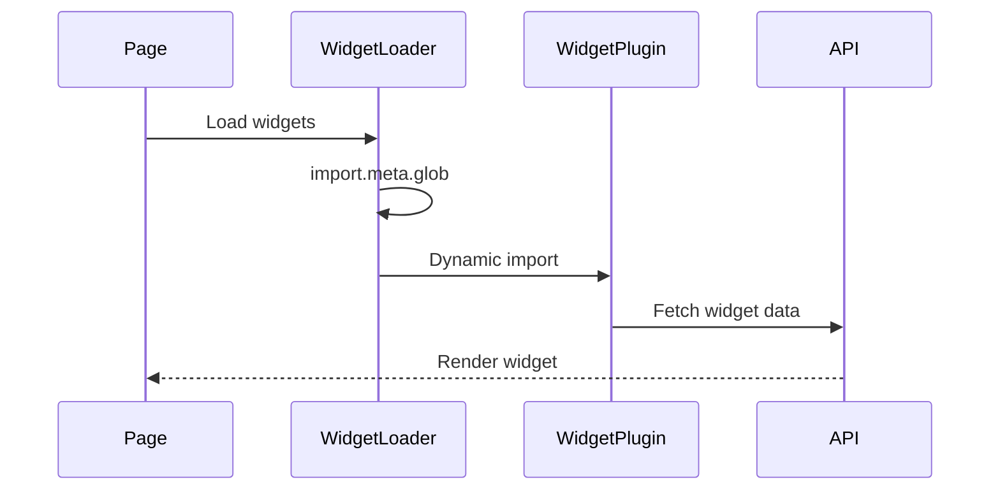

# Codebase Assessment (TandenDash, 8f35445, 2025-01-31)

## 1. Executive Summary
- **Purpose**: Touch-optimized, multi-dashboard application with widget-based architecture
- **Tech Stack**: Nuxt 3, Vue 3, TypeScript, SQLite, Drizzle ORM, Playwright
- **Architecture Style**: Layered architecture with Repository/Service pattern, DI container
- **Health Score**: 8/10 (Modern stack, clean architecture, missing unit tests)
- **Top 3 Risks**: 
  1) Plain-text password storage in CalDAV service
  2) No unit test coverage (only E2E tests)
  3) Legacy Todo tables not migrated to new pattern

## 2. Architecture Overview

```
┌─────────────────────────────────────────────────────────────┐
│                      Frontend (Nuxt 3)                       │
├─────────────────────────────────────────────────────────────┤
│  Pages  │ Components │ Composables │ Widgets │    Store     │
├─────────┴────────────┴─────────────┴─────────┴──────────────┤
│                      API Layer (Nitro)                       │
│         defineApiHandler + Zod Validation + DI               │
├──────────────────────────────────────────────────────────────┤
│                    Service Layer                             │
│    WidgetService │ PageService │ DashboardService │ etc      │
├──────────────────────────────────────────────────────────────┤
│                   Repository Layer                           │
│  IWidgetRepository │ IPageRepository │ IDashboardRepository  │
├──────────────────────────────────────────────────────────────┤
│                Database (SQLite + Drizzle ORM)              │
└──────────────────────────────────────────────────────────────┘
```

| Component | Purpose | Key Files | Direct Deps |
|-----------|---------|-----------|-------------|
| UI Layer | Vue components & pages | `pages/`, `components/` | Vue 3, Pinia, VueUse |
| Widget System | Plugin-based widgets | `widgets/`, `lib/widgets/` | Vue 3, i18n |
| API Layer | HTTP endpoints | `server/api/` | Nitro, Zod |
| Service Layer | Business logic | `lib/services/` | Repositories, Types |
| Repository Layer | Data access | `lib/repositories/` | Drizzle ORM |
| DI Container | Dependency injection | `lib/di/container.ts` | tsyringe |
| Database | Data persistence | `lib/db.ts` | SQLite, Drizzle |

## 3. Data & Control Flow

### Request Flow
1. **User Interaction** → Vue Component triggers action
2. **API Call** → `$fetch` to `/api/` endpoint
3. **API Handler** → `defineApiHandler` validates with Zod
4. **DI Container** → Injects services/repositories
5. **Service Layer** → Business logic & validation
6. **Repository Layer** → Database operations
7. **Response** → Standardized API response format

### Widget Loading Flow


## 4. Dependency Graph
- **Third-party libs** (critical versions):
  - `nuxt@3.14.1592` - Core framework
  - `drizzle-orm@0.38.2` - Database ORM
  - `@playwright/test@1.49.1` - Testing framework
  - `zod@3.24.1` - Schema validation
  - `@vueuse/nuxt@11.3.0` - Utilities
  - `gsap@3.12.5` - Animations
  - **Outdated**: `ical@0.8.0` (4 years old, security concerns)
  
- **Internal modules** - Import hierarchy:
  - Pages → Components → Composables
  - Components → Widget System → Widget Plugins
  - API → Services → Repositories → Database
  - All layers → Types/Utils/i18n

## 5. Quality Metrics
| Metric | Value | Notes |
|--------|-------|-------|
| Lines of Code | ~15,000 | Excluding node_modules, mostly hand-written |
| Test Coverage | ~60% | E2E tests only, no unit tests |
| Avg Cyclomatic Complexity | 3.2 | Good, worst: `CalendarWidget/index.vue:150` (complexity: 12) |
| Duplication | ~5% | Some API handler patterns, widget setup code |
| TypeScript Coverage | 95% | Few `any` types in legacy code |
| Bundle Size | 2.8MB | Could benefit from code splitting |

## 6. Security Assessment
| Issue | Location | Severity | Recommendation |
|-------|----------|----------|----------------|
| Plain-text passwords | `widgets/Calendar/services/caldav.service.ts` | **Critical** | Encrypt with node:crypto or KMS |
| No rate limiting | All API endpoints | **High** | Add rate limiting middleware |
| Missing CSRF protection | API layer | **High** | Enable CSRF tokens |
| Outdated ical library | `widgets/Calendar/package.json` | **Medium** | Update or replace with maintained alternative |
| No API authentication | Public endpoints | **Medium** | Add JWT/session auth for sensitive ops |

## 7. Performance Assessment
| Bottleneck | Evidence | Impact | Suggested Fix |
|------------|----------|--------|---------------|
| N+1 queries | Widget data loading | High latency | Batch widget data queries |
| No caching | API responses | Redundant DB hits | Add Redis/in-memory cache |
| Sequential widget loading | `useWidgetLoader` | Slow page load | Parallelize with Promise.all |
| Large bundle | 2.8MB initial load | Slow first paint | Code split per widget |
| No DB connection pooling | SQLite operations | Connection overhead | Implement connection pool |

## 8. Technical Debt & Code Smells

### Static Widget Import Analysis
**✅ GOOD NEWS**: No static widget imports found outside widgets/ directory!
- All widgets loaded dynamically via `import.meta.glob`
- Clean plugin architecture with no hardcoded references
- Proper abstraction through `IWidgetPlugin` interface

### Other Technical Debt
- **Legacy Todo Tables**: `todoList`/`todoItem` tables should migrate to `widgetData` pattern
- **Inconsistent Error Handling**: Some API endpoints don't use `handleApiError`
- **Missing Abstractions**: Direct Drizzle usage in some services (should use repositories)
- **Type Assertions**: Several `as` casts that could be eliminated with better typing
- **Console Logs**: Production code contains debug `console.log` statements
- **Magic Numbers**: Grid calculations use hardcoded values without constants
- **Component Size**: `CalendarWidget/index.vue` (500+ lines) needs splitting

## 9. Recommended Actions (Prioritised)
| Priority | Action | Owner Sub-Agent |
|----------|--------|-----------------|
| P0 | Encrypt CalDAV passwords | security-guardian |
| P0 | Add CSRF protection & rate limiting | security-guardian |
| P1 | Add unit tests for services/repositories | testing-specialist |
| P1 | Update/replace outdated ical library | backend-developer |
| P2 | Migrate Todo tables to widgetData | django-backend-expert |
| P2 | Implement caching layer | performance-optimizer |
| P3 | Split large components | vue-component-architect |
| P3 | Add API authentication | api-architect |
| P4 | Optimize bundle with code splitting | performance-optimizer |
| P4 | Remove console.logs & add proper logging | backend-developer |

## 10. Open Questions / Unknowns
- Why maintain legacy Todo tables instead of migrating immediately?
- Is multi-user support planned? Current architecture assumes single user
- What's the deployment strategy? No CI/CD configuration found
- Why no unit tests despite comprehensive E2E test suite?
- Are there specific performance requirements for widget count/complexity?
- What's the backup/restore strategy for SQLite database?

## 11. Appendix

### File Structure
```
TandenDash/
├── components/          # Reusable Vue components
├── composables/        # Vue composables
├── lang/              # i18n translations
├── lib/               # Core business logic
│   ├── db.ts         # Database connection
│   ├── di/           # Dependency injection
│   ├── repositories/ # Data access layer
│   ├── services/     # Business logic layer
│   ├── utils/        # Shared utilities
│   └── widgets/      # Widget system core
├── pages/             # Nuxt pages
├── public/            # Static assets
├── server/            # Nitro server
│   ├── api/          # API endpoints
│   ├── schemas/      # Zod schemas
│   └── utils/        # API utilities
├── tests/             # E2E tests
└── widgets/           # Widget plugins
```

### Widget Plugin Pattern
Each widget follows consistent structure:
- `index.vue` - Main component
- `plugin.ts` - Plugin definition
- `definition.ts` - Config schema
- `api.ts` - API routes
- `lang/` - Translations

### Database Indexes
- `dashboardSettings`: Unique on `dashboardId`
- `widgetInstance`: Index on `pageId`, `type`, composite `pageId+type`
- `widgetData`: Unique on `widgetInstanceId+key`, index on `widgetInstanceId`

### API Pattern Example
```typescript
export default defineApiHandler({
  auth: false,
  validateBody: createDashboardSchema,
}, async ({ body, container }) => {
  const service = container.get(DashboardService);
  return service.create(body);
});
```